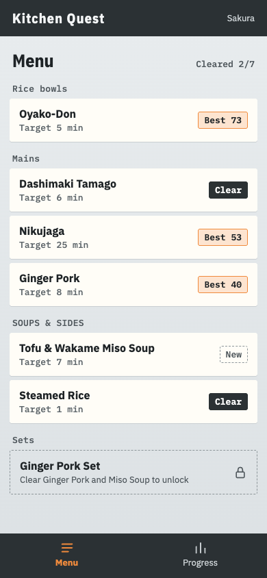
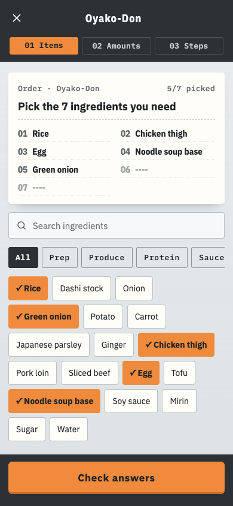
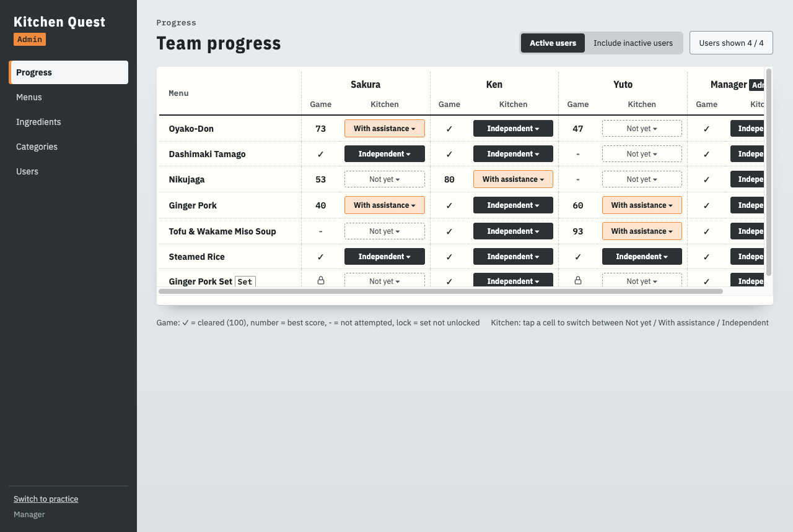

# Kitchen Quest

A training web app for restaurant kitchen staff. Staff study each menu item's ingredients, amounts and steps, then check what they remember with a game. Admins manage recipes, record who can cook what in the kitchen, and see everyone's progress at a glance.

> Status: planning complete, implementation starting.

## Screens

| Menu list | Game | Team progress |
|---|---|---|
|  |  |  |

All screens: [docs/screens.md](docs/screens.md).

## Features (MVP)

- **Study**: ingredients, amounts and steps for each menu item, with a hide & practice mode
- **Game**: pick the ingredients, answer amount questions, put the steps in order, get a score out of 100
- **Set menus** that unlock after their components are cleared
- **Team progress**: game scores and kitchen status (Not yet / With assistance / Independent) for every user
- English and Japanese UI

## Tech stack

React + TypeScript (Vite), MUI, Supabase (Postgres, Auth, Storage, RLS, Edge Functions), i18next, Netlify. Details and reasons: [docs/architecture.md](docs/architecture.md).

## How this was built

This project is developed with AI as a collaborator, from planning to code.

1. **Requirements**: brainstormed with Claude through many rounds of questions and trade-offs, then written up in [docs/requirements.md](docs/requirements.md).
2. **Design**: screens designed with Claude Design, including palette studies and contrast checks. Tokens in [docs/design-tokens.md](docs/design-tokens.md).
3. **Architecture**: options compared (SPA vs Next.js, Edge Functions vs Netlify Functions, MUI vs Tailwind, Supabase vs Firebase) and recorded in [docs/decisions.md](docs/decisions.md).
4. **Implementation**: with Claude Code, guided by [CLAUDE.md](CLAUDE.md).

## Documentation

| Document | Contents |
|---|---|
| [requirements.md](docs/requirements.md) | What the app does and why |
| [screens.md](docs/screens.md) | Screens and URLs |
| [data-model.md](docs/data-model.md) | Tables and access rules |
| [architecture.md](docs/architecture.md) | Stack, environments, deployment |
| [design-tokens.md](docs/design-tokens.md) | Colors, fonts, theme |
| [decisions.md](docs/decisions.md) | Key technical decisions and why |

## Getting started

<!-- Added once the project is scaffolded -->

## License

All rights reserved. This repository is public for portfolio review.
